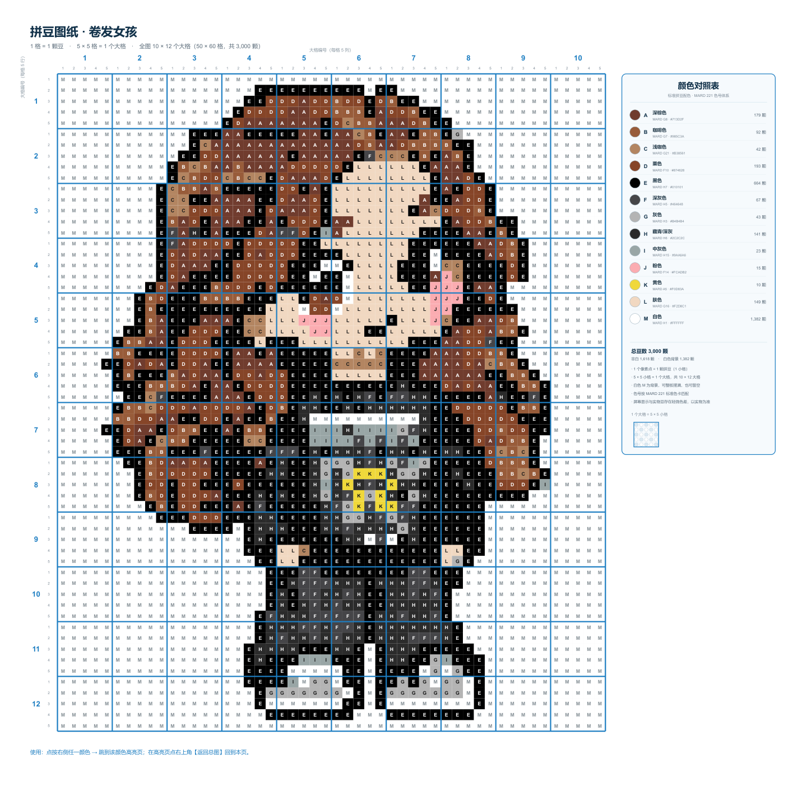
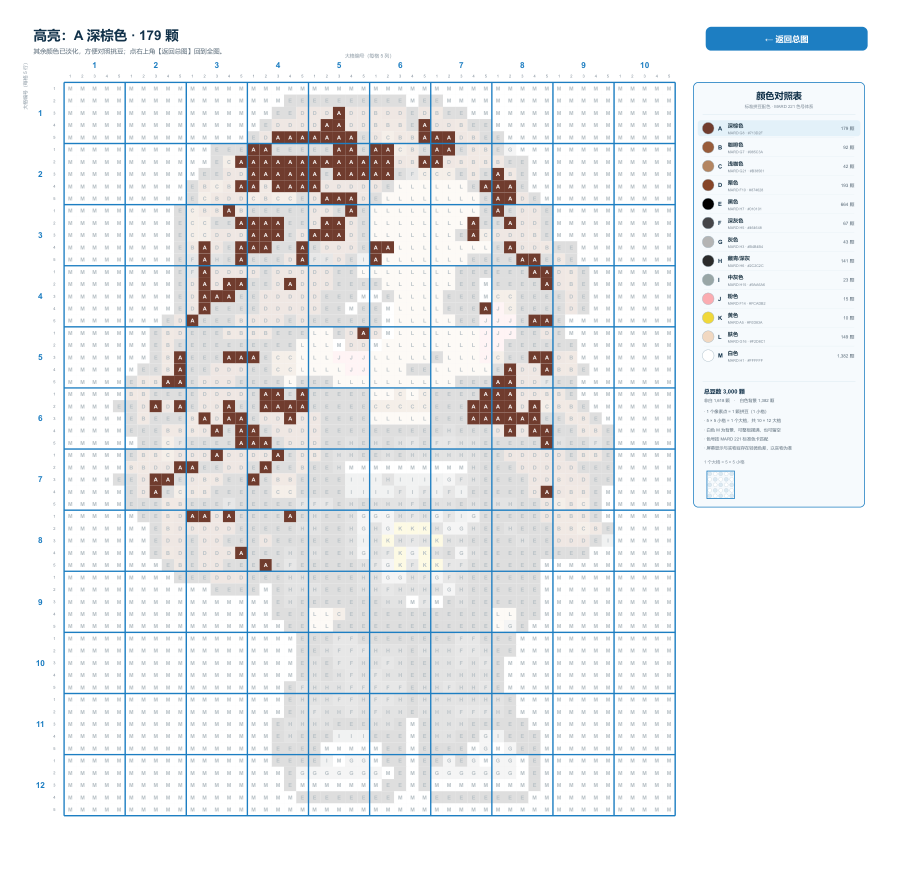
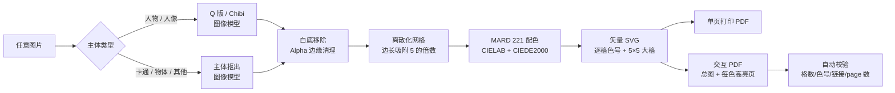

<div align="center">


# Bead Pattern Skill

**Turn any image into a standard-colour bead pattern with an interactive, zero-install PDF.**

把任意图片变成「1 格 = 1 颗豆、5×5 = 1 大格、逐格标色号」的专业拼豆图纸，
并自动交付一份在 iPhone / iPad / 安卓上打开就能点颜色高亮的交互式 PDF。

[](https://www.python.org/)
[](LICENSE)
[](#-outputs)
[](#-use-as-a-claude-skill)
[](#-contributing)
[](https://github.com/yhsun060421/--picture2pdf-skill/releases)

[查看示例交互 PDF](assets/sample-interactive.pdf) · [效果图](assets/preview-overview.png) · [问题反馈](https://github.com/yhsun060421/--picture2pdf-skill/issues)

</div>

---

## ✨ 为什么不是“又一个像素化工具”

- **不是简单缩放图片。** 每个格子都经过 CIELAB 聚类 + CIEDE2000 匹配，最终落到
  **MARD 221 标准拼豆色号**，不会出现“看着差不多”的假颜色。
- **不是一张死图。** 交付的是 **1 + N 页交互式 PDF**：点右侧任一颜色，跳到该颜色的
  高亮页；点「返回总图」回到全图。苹果「图书 / 文件」原生打开，**零 App、零联网**。
- **不是随便切格子。** 格数自动吸附到 5 的倍数，保证每个 5×5 大格完整；每一格都写着
  颜色代号与用量。
- **不是只给你一张图。** 同时产出打印 PDF、可编辑 SVG、PNG 预览、JSON/Markdown 报告。
- **为“完全不懂技术的人”设计。** 买家拿到 PDF 就会用；卖家拿到脚本就能批量出图。

## 🎬 效果

| 总图（第 1 页） | 点击颜色后（高亮页） |
|---|---|
|  |  |

> GIF 与截图均由 [`assets/sample-interactive.pdf`](assets/sample-interactive.pdf) 直接渲染。
> 示例：50×60 格 / 10×12 大格 / 13 色 / 3,000 颗。

## 📦 Releases

[v1.0.0](https://github.com/yhsun060421/--picture2pdf-skill/releases) 提供示例交互 PDF 与完整 Skill 压缩包下载。

## 🧠 流程



图像预处理使用**使用者自带的图像模型**（base URL + API key），不上传、不内置密钥。
如果图片本身已经是干净抠图，直接 `--mode none` 跳过模型。

## 🚀 快速开始

```bash
git clone https://github.com/yhsun060421/--picture2pdf-skill.git
cd bead-pattern-skill
pip install -r requirements.txt
```

配置图像模型（以 OpenAI 兼容接口为例）：

```bash
export BEAD_IMG_BASE_URL="https://api.openai.com"
export BEAD_IMG_API_KEY="sk-..."
export BEAD_IMG_MODEL="gpt-image-1"          # 可选
export BEAD_IMG_API_STYLE="openai"           # openai | chat
```

> Windows CMD 用 `set VAR=value`；PowerShell 用 `$env:VAR="value"`。
> 密钥只从环境变量读取，**不会写入任何输出文件**。

先用内置示例跑通（无需 API key）：

```bash
python scripts/run_pipeline.py --input examples/sample.png --out outputs/demo --title "示例图纸" --mode none --colors 8 --max-cells 30
```

处理真人照片（需要上面的图像模型）：

```bash
python scripts/run_pipeline.py --input /path/to/photo.jpg --out outputs/girl --title "卷发女孩" --mode chibi --colors 13 --max-cells 60
```

> 需要本机安装 **Chrome / Edge**（用于把矢量 SVG 打印成 PDF）。
> 找不到时设置 `BEAD_CHROME=/path/to/chrome`。

## ⚡ AI 一键安装（开箱即用）

**macOS / Linux**

```bash
curl -fsSL https://raw.githubusercontent.com/yhsun060421/--picture2pdf-skill/main/install.sh | bash
```

**Windows PowerShell**

```powershell
irm https://raw.githubusercontent.com/yhsun060421/--picture2pdf-skill/main/install.ps1 | iex
```

**直接让 AI 安装**

> 请把 https://github.com/yhsun060421/--picture2pdf-skill 克隆到
> `~/.claude/skills/bead-pattern`，安装 `requirements.txt`，运行
> `python scripts/doctor.py`，然后用 `examples/sample.png` 跑一遍 `--mode none` 验证。

安装完成后重启 Claude Code，Skill 会自动被发现。之后直接说：

> 把这张照片做成拼豆图纸，Q 版，13 色，交互 PDF。

Claude 会读取 [`SKILL.md`](SKILL.md)，按“取图 → 预处理 → 网格 → 标准色 → SVG →
交互 PDF → 校验”的固定流程执行，并在缺少 API key 时主动询问。

手动安装：

```bash
git clone https://github.com/yhsun060421/--picture2pdf-skill.git ~/.claude/skills/bead-pattern
pip install -r ~/.claude/skills/bead-pattern/requirements.txt
python ~/.claude/skills/bead-pattern/scripts/doctor.py
```

## 🎨 配色为什么可信

| 步骤 | 做法 |
|---|---|
| 1. 提取 | 每个格子的平均色在 **CIELAB** 空间参与加权聚类 |
| 2. 选色 | 加权 k-means 选代表色（默认 12 色，可调 6–20） |
| 3. 落地 | 每个代表色用 **CIEDE2000** 匹配到最近的 **MARD 221** 标准色 |
| 4. 去重 | 色差小于 `--min-delta`（默认 6）的颜色合并，保证实际可拼 |
| 5. 回填 | 每个格子最终分配到某个**真实 MARD 色号**，绝不使用插值出来的假 HEX |
| 6. 校验 | 报告里逐色列出 MARD 色号、HEX、用量；总量必须等于格数 |

- 色卡数据来自 [HansBug/pindou-color-data](https://github.com/HansBug/pindou-color-data)
  （MIT License），MARD 221 是国内拼豆最主流的色号体系。
- 色卡 JSON 原样保留在 [`references/palette-mard221.json`](references/palette-mard221.json)，
  可审计、可替换。
- 颜色名（深棕 / 浅灰 / 橄榄…）只是**按 HSL 生成的描述名**，采购时以 MARD 色号为准。

## 📦 Outputs

每次运行输出到 `--out` 目录：

| 文件 | 内容 |
|---|---|
| `pattern-interactive.pdf` | **主交付物**：总图 + 每种颜色一页高亮；图例可点、可返回；Apple Books / 文件 / 任意 PDF 阅读器可用 |
| `pattern.pdf` | 单页矢量图纸，适合打印 |
| `pattern.svg` | 纯矢量源文件，可编辑/改色/导入设计软件 |
| `preview.png` | 首屏预览图 |
| `report.md` | 人类可读清单：网格、色号、HEX、用量、校验结果 |
| `report.json` | 机器可读的完整报告 |
| `preprocessed.png` | 预处理后的透明底主体，便于复查 |

交互 PDF 的每一页都包含同一张图例，所以可以**在高亮页直接点另一种颜色**切换，不用先返回。

## 🖨️ 交互式 PDF：为什么适合苹果用户

iOS 的 Safari **不能直接打开本地 HTML**，普通买家也不会去装编辑器或起本地服务器。
交互 PDF 用标准 PDF 内部链接实现交互：

- 总图：点图例 → 目标颜色高亮页
- 高亮页：点右上角「返回总图」→ 第 1 页
- 高亮页：点其他颜色 → 直接切换
- 淡化色采用**预混合实色**（不是透明度组），兼容性更好、文件更小
- 实测 14 页 ≈ 10 MB，矢量放大不糊

## ⚙️ 参数

| 参数 | 默认 | 说明 |
|---|---|---|
| `--input` | 必填 | 输入图片 |
| `--out` | 必填 | 输出目录 |
| `--title` | `拼豆图纸` | 图纸标题 |
| `--mode` | `auto` | `chibi` 人物 Q 版 / `cutout` 抠主体 / `none` 已抠图 |
| `--colors` | `12` | 最多颜色数（6–20） |
| `--max-cells` | `60` | 最长边格数，自动吸附到 5 的倍数 |
| `--cols` / `--rows` | — | 显式指定格数（必须是 5 的倍数） |
| `--pad-cells` | `0` | 四周留白格数 |
| `--min-delta` | `6.0` | 两个标准色之间的最小 CIEDE2000 |
| `--fixed-palette` | — | 固定 MARD 色号，如 `H7,G8,G7,F10,H1` |
| `--fade-ratio` | `0.13` | 高亮页中非目标色的淡化比例 |
| `--chrome` | 自动 | Chromium 可执行文件路径 |

环境变量：`BEAD_IMG_BASE_URL`、`BEAD_IMG_API_KEY`、`BEAD_IMG_MODEL`、
`BEAD_IMG_API_STYLE`、`BEAD_CHROME`。

## 🧪 校验

`scripts/validate.py` 会检查：

- SVG 格子数 = `cols × rows`
- 两个维度都是 5 的倍数
- 调色板用量总和 = 总格数
- 色号只使用 `A–T`，HEX 合法
- 交互 PDF 页数 = `1 + 颜色数`
- 第 1 页链接数 = 颜色数；高亮页链接数 = 颜色数 + 1
- 所有声明输出文件真实存在

校验失败脚本以非 0 退出，**不要把失败的结果交付给买家**。

## 🗂️ 项目结构

```text
bead-pattern-skill/
├── SKILL.md                     # Claude Skill 入口与硬性规范
├── README.md
├── requirements.txt
├── install.sh / install.ps1     # 一键安装
├── INSTALL.md                   # AI / 人类安装说明
├── LICENSE
├── NOTICE
├── beadlib/
│   ├── palette.py               # MARD 221 / Lab / CIEDE2000 / k-means
│   ├── preprocess.py            # 图像模型调用 + 白底移除
│   ├── quantize.py              # 图片 -> 5×5 网格
│   ├── render_svg.py            # 矢量图纸模板
│   ├── interactive_pdf.py       # 高亮页 + 内部链接
│   └── pipeline.py              # 端到端 CLI
├── scripts/
│   ├── run_pipeline.py
│   ├── validate.py
│   ├── make_preview.py
│   └── doctor.py               # 环境自检
├── references/
│   ├── palette-mard221.json     # 221 个标准色（MIT）
│   ├── palette-methodology.md
│   ├── prompts.md
│   ├── output-spec.md
│   └── troubleshooting.md
├── templates/style.json         # 版式参数（可改主题色/格子尺寸）
├── examples/sample.png          # 可离线跑通的示例输入
└── assets/                      # 示例 PDF / GIF / 截图
```

## ❓ FAQ

**没有图像模型 API 能用吗？**
可以。先用其他工具把主体抠成透明 PNG，然后 `--mode none`。

**白色鞋子/白色主体被抠掉了？**
白底上的白色主体容易被边缘漫水填充误删。请使用透明背景 PNG，或让预处理输出
非纯白背景（浅蓝/浅灰）后再抠图。

**提示找不到 Chrome？**
安装 Chrome 或 Edge，或设置 `BEAD_CHROME`。PDF 生成依赖 Chromium 的打印引擎。

**颜色太少/细节丢了？**
提高 `--max-cells`（如 75）和 `--colors`（如 15），再跑一次；先看 `preview.png`。

**能指定 65×65 吗？**
可以：`--cols 65 --rows 65`。注意两个维度必须是 5 的倍数，因此 65 是合法的。

**买家是苹果设备怎么办？**
直接发 `pattern-interactive.pdf`。不要发本地 HTML。

**图像版权？**
输入图片与生成图纸的权利归使用者；本项目只提供转换工具。示例角色仅用于演示。

## 🤝 Contributing

欢迎 PR：新的标准色卡适配、更好的背景移除、更多语言、额外的输出格式（PNG 分页、
A4 拼版、PWA）。提交前请运行：

```bash
python scripts/run_pipeline.py --input examples/sample.png --out outputs/demo --title "示例图纸" --mode none --colors 8 --max-cells 30
python scripts/validate.py --out outputs/demo
```

## 📜 License & Acknowledgements

- 代码：[MIT](LICENSE)
- 拼豆色卡数据：[HansBug/pindou-color-data](https://github.com/HansBug/pindou-color-data)
  · MIT · Copyright (c) 2026 HansBug（完整许可见 [`NOTICE`](NOTICE)）
- 示例角色图：由项目作者提供，仅用于演示交互 PDF 的效果
- 字体：使用系统字体回退（PingFang SC / Microsoft YaHei / Noto Sans CJK），不内嵌字体

---

<div align="center">
<sub>如果这个项目帮你卖出了第一份拼豆图纸，欢迎点一个 ⭐。</sub>
</div>
